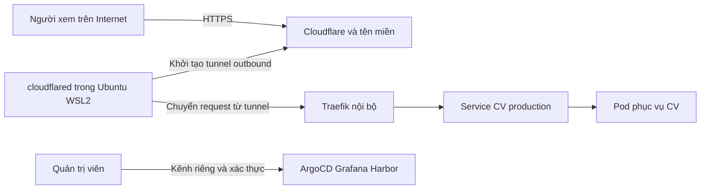

# Hướng dẫn xây dựng và vận hành website CV trên máy cá nhân

Ngày biên soạn: 19 tháng 10 năm 2026.

Mục tiêu của dự án là đưa một website CV ra Internet từ máy cá nhân, tự phục hồi sau khi khởi động máy và kết nối mạng, đồng thời thực hành đủ sáu phase trong Intern Roadmap và bổ sung bảo mật, monitoring, tự động hóa hạ tầng, sao lưu và xử lý sự cố.

Đích đến là một hệ thống có thể giải thích, kiểm tra và dựng lại được. Không có cấu hình nào bảo đảm tuyệt đối không bị tấn công. Máy cá nhân, đường truyền nhà và một node Kubernetes vẫn là các điểm lỗi đơn. Hai replica trên cùng máy không tạo ra khả năng chịu lỗi khi máy đó tắt.

Đây là bản thiết kế và hướng dẫn thực hành. Theo lựa chọn mới của người học, phần nền Linux dùng Ubuntu WSL2 hiện có, thay cho VM VirtualBox riêng. Đã cấu hình giới hạn WSL2, kiểm tra systemd và tạo workspace Linux; website, tunnel, cluster và pipeline vẫn là các mốc triển khai tiếp theo.

Thông tin người học đã xác nhận: dùng Windows, RAM 16 GB, tên miền `khimkum.xyz` và có thể dành 6 đến 7 giờ mỗi ngày. Ưu tiên hoàn thiện đúng và hiểu hệ thống, không đặt thời hạn cứng. Lộ trình chuyển chặng theo bằng chứng nghiệm thu; không bỏ phase để giảm thời gian. Các lựa chọn thêm máy, nâng RAM hoặc thuê tài nguyên chỉ được quyết định khi có số liệu và ngân sách, không phải điều kiện để bắt đầu học Linux và làm CV.

## 1 Phạm vi và cách đối chiếu roadmap

Tài liệu nguồn là `C:\Users\levan\Downloads\Intern Roadmap.docx`. Nội dung của tài liệu được dùng làm yêu cầu học tập tham chiếu. Các đề xuất bổ sung dưới đây là thiết kế cho dự án, không phải nội dung có sẵn trong file Word.

| Phase trong tài liệu | Phần phải thực hiện trong dự án | Bằng chứng hoàn thành |
| --- | --- | --- |
| 1 Linux Fundamentals | Quản trị Linux VM, user, permission, process, systemd, SSH, network, log, disk, script | VM tự khởi động dịch vụ; giải thích và xử lý một lỗi permission, một lỗi DNS |
| 2 Docker và Container Registry | Image, container, daemon, multi-stage Dockerfile, Compose, Kaniko, Harbor, push và pull, phân quyền | Build image CV; push Harbor; pull và chạy lại ở môi trường sạch |
| 3 Kubernetes Core Concepts | Kiến trúc, Pod, ReplicaSet, Deployment, Service, Ingress, ConfigMap, Secret, namespace, quota, volume, kubectl | Tự viết và apply Deployment, Service, Ingress; giải thích đường đi request |
| 4 GitLab CI Pipeline | Runner và executor, stage và job, test, image build, push Harbor, variables, cache, artifacts | Pipeline từ commit đến image theo commit SHA; bài Kaniko riêng |
| 5 GitOps và ArgoCD | Tách app repo và config repo, Application, sync thủ công/tự động, rollback | Sửa Git và quan sát ArgoCD đồng bộ; chứng minh CI không cần kubeconfig |
| 6 CI CD End to End | Staging, approve trước production, promote, rollback, README và demo | Cùng image digest đi qua staging và production, có lịch sử duyệt và diễn tập lỗi |

Phase 1 trong file chỉ có mô tả tổng quan, chưa có checklist chi tiết. Checklist Linux ở phần 5 là phần bổ sung. Image Updater là tùy chọn trong roadmap, có thể học sau khi đã làm thành công việc cập nhật manifest bằng pipeline.

Monitoring phải có Prometheus và Grafana theo yêu cầu bổ sung. Không coi dashboard có dữ liệu là đủ: phải có cảnh báo, kiểm tra từ bên ngoài và bài diễn tập khi hệ thống hỏng.

## 2 Các quyết định kiến trúc

### Website

Làm website tĩnh bằng Astro hoặc công cụ tạo trang tĩnh tương đương mà bạn đã biết. Bản hướng dẫn chọn Astro để có bước cài dependency, build và test rõ ràng; output cuối cùng là HTML, CSS, JavaScript và tài nguyên tĩnh. Container runtime chỉ cần web server chạy bằng user thường trên cổng 8080.

CV gồm giới thiệu, kỹ năng, dự án, liên kết GitLab/GitHub, email và bản CV tải xuống. Kiểm tra nội dung trên điện thoại và desktop. Không đưa địa chỉ nhà, giấy tờ hay thông tin riêng không cần thiết lên CV. Dùng liên kết email trước; form liên hệ, upload, đăng nhập và database chỉ bổ sung khi có yêu cầu nghiệp vụ cụ thể.

Học persistence bằng dữ liệu Harbor và monitoring. Không cần tạo database cho một CV tĩnh chỉ để thêm công nghệ.

### Máy chạy và mạng

Phương án đã chọn là Windows Terminal -> distro Ubuntu chạy WSL2. WSL2 cung cấp kernel Linux trong máy ảo nhẹ do Windows quản lý; không cần tạo thêm VM VirtualBox hoặc cài lại Ubuntu. Trước mốc public lâu dài, phải chứng minh việc tự khởi động WSL sau Windows boot, giữ workload hoạt động khi đóng terminal và phục hồi kết nối mạng. [Microsoft WSL2](https://learn.microsoft.com/en-us/windows/wsl/compare-versions).

Máy đang mở workspace được kiểm tra chỉ đọc ngày 19 tháng 10 năm 2026: Windows 11 Home, khoảng 15,8 GiB RAM, CPU i7-8565U với 4 core/8 logical processor, ổ F còn khoảng 226 GiB; có VirtualBox 7.1.4. Nếu đây là máy dự kiến làm server, dùng cấu hình từng chặng bên dưới thay vì bật ba VM đầy đủ ngay từ đầu. Số RAM rảnh khoảng 4,3 GiB tại lúc kiểm tra chỉ phản ánh các ứng dụng đang chạy khi đó.

Ubuntu WSL đã kiểm tra: Ubuntu 26.04.1 LTS, user thường `khimkum`, PID 1 là systemd và trạng thái systemd là running; có Git và curl. Không cần thay đổi BIOS, Windows edition hoặc cài thêm hypervisor cho bước bắt đầu.

Đề xuất khởi đầu trên máy này:

1. Phase Linux: dùng Ubuntu WSL2, tối đa 3 GB RAM, 2 logical processor, swap 2 GB. Cấu hình đã ghi tại `C:\Users\levan\.wslconfig` và xác minh sau khi khởi động lại WSL. Đây là giới hạn dùng chung cho WSL2, gồm Docker Desktop khi bật; không phải 3 GB cho mỗi distro.
2. Phase Docker, Kubernetes và monitoring: đo mức sử dụng rồi tăng giới hạn chung khi cần, chẳng hạn 4 đến 6 GB RAM và thêm CPU phù hợp. Một node, retention ngắn, không mặc định build nặng cùng lúc. Đây là ngân sách thử nghiệm, không bảo đảm mọi chart mặc định sẽ vừa.
3. Harbor và runner học trong VM cách ly theo từng buổi khi các lab khác có thể tạm dừng. Trước buổi demo đủ chuỗi, bố trí thêm tài nguyên cho Harbor/runner, chẳng hạn một máy lab khác hoặc VM bên ngoài có mạng riêng và TLS. Origin CV vẫn nằm trên máy cá nhân; không cần public Harbor chỉ để nối pipeline.
4. Nếu tất cả thành phần bắt buộc chạy đồng thời trên cùng máy, cần đánh giá nâng tài nguyên hoặc tinh chỉnh từ số liệu thực tế. Không ghép runner có quyền rộng vào runtime public để tiết kiệm RAM rồi coi đó là mức bảo mật tương đương.

Workspace duy nhất là `F:\Devops_Lab` theo yêu cầu của người học. Trong Ubuntu WSL, chính folder này có đường dẫn `/mnt/f/Devops_Lab`. Source, Git, tài liệu và script cùng nằm tại đây; mở Terminal WSL và chạy lệnh Linux trong folder này. Không dùng một bản dự án riêng trong home Linux. [Microsoft về filesystem WSL](https://learn.microsoft.com/en-us/windows/wsl/filesystems).

Không tạo thêm ổ 60 GB hoặc thu nhỏ VHD đang có. Filesystem Linux hiện báo dung lượng logic khoảng 1 TB nhưng đó không phải lượng dung lượng vật lý được cấp sẵn. Theo dõi cả disk bên trong Linux và chỗ trống ổ Windows thực sự lưu VHD; đừng giả định còn gần 1 TB để tải image.

Lệnh mở workspace từ PowerShell:

```powershell
wsl -d Ubuntu --cd /mnt/f/Devops_Lab
```

Lệnh kiểm tra lại môi trường từ Ubuntu:

```bash
cd /mnt/f/Devops_Lab
bash scripts/verify-foundation.sh
cat docs/linux/ENVIRONMENT.txt
```

Không mount thư mục tài liệu cá nhân, SSH key cá nhân hay socket điều khiển container không cần thiết vào workload public hoặc job CI. Ubuntu WSL hiện vẫn có tích hợp filesystem Windows và interop mặc định. Chưa xem baseline này là môi trường đã sẵn sàng public; phải đánh giá automount, interop, mạng và secrets trước khi đưa website ra Internet. Tắt automount chỉ giảm truy cập thuận tiện, không tạo ra ranh giới bảo mật tuyệt đối nếu process có quyền đủ cao. Cập nhật Windows, WSL và Ubuntu theo lịch.

Thiết kế đầy đủ phân biệt ba vai trò dưới đây. Các VM/tài nguyên bổ sung là lựa chọn cho giai đoạn tích hợp khi cần cách ly và đủ tài nguyên; chúng không phải ba VM phải tạo ngay bây giờ. Nhiều distro WSL cùng máy không được coi là các vùng cách ly tương đương VM độc lập.

| VM | Thành phần | Ước lượng RAM ban đầu | Quyền truy cập chính |
| --- | --- | --- | --- |
| runtime | K3s, Traefik, cloudflared, CV staging/prod, ArgoCD, monitoring | 6 đến 8 GB | Pull image Harbor, đọc Git, kết nối tunnel ra ngoài |
| registry | Harbor và dữ liệu registry | Từ 4 GB | Nhận push từ runner và pull từ runtime qua HTTPS nội bộ |
| runner | GitLab Runner và image builder | 3 đến 4 GB, concurrency 1 | Nhận job bằng kết nối outbound đến GitLab, push Harbor |

Đây là ngân sách thiết kế cho phương án đầy đủ, không phải cam kết tài nguyên tối thiểu của từng sản phẩm. Máy 32 GB RAM và SSD còn khoảng 120 đến 200 GB là điểm bắt đầu thực tế để chạy đồng thời và vẫn dành tài nguyên cho host. Đo RAM, CPU, disk và điều chỉnh retention sau khi có số liệu. Máy 16 GB có thể học theo từng chặng; không mặc định bật toàn bộ stack và build nặng cùng lúc. Việc học từng chặng chưa thay thế buổi nghiệm thu toàn bộ luồng hoạt động đồng thời.

Các VM dùng mạng lab riêng có NAT/định tuyến được kiểm soát. NAT không tự ngăn guest truy cập host hoặc mạng LAN. Cần ACL tại hypervisor/router/firewall để chặn lab và runner đi tới tài nguyên cá nhân, giao diện quản trị router, SMB/RDP và mạng gia đình; chỉ cho phép các đích và luồng cần thiết. Cho phép DNS, gateway/NAT và dịch vụ quản trị theo sơ đồ cụ thể để tránh tự làm mất kết nối. Kiểm tra cả IPv4 và IPv6. Nếu thiết bị không hỗ trợ cách ly đủ tốt, cân nhắc máy lab riêng cho runtime public.

Namespace staging và production trên cùng cluster giúp phân tách cấu hình và quota. Chúng không phải ranh giới cách ly tương đương hai cluster/máy vật lý độc lập.

### Cách công khai website

Dùng tên miền `khimkum.xyz` và named Cloudflare Tunnel. Địa chỉ dự kiến của CV production là `https://khimkum.xyz`; `www.khimkum.xyz` có thể được cấu hình chuyển hướng về địa chỉ chính sau khi DNS hoạt động. Mô hình này phù hợp cả khi mạng nhà không có IP public cố định. Không cấu hình port forwarding cho website; kiểm tra không còn luật chuyển tiếp cũ và tắt UPnP nếu không cần.

Người học đã cung cấp tên miền. Triển khai theo ba mốc:

1. Linux, website và container chạy local; chưa cần mở tunnel để hoàn thành nền tảng Linux.
2. Nhà cung cấp đăng ký là GoDaddy. Người dùng đã thêm tên miền vào Cloudflare. Ngày 20 tháng 10 năm 2026, cả Cloudflare và Google Public DNS đã phân giải đúng cặp NS `jay.ns.cloudflare.com`, `julissa.ns.cloudflare.com`. DNS delegation đã hoạt động; route tunnel và website public vẫn cần triển khai, kiểm chứng riêng. Hướng dẫn và lịch sử kiểm tra nằm trong `docs/network/DOMAIN.vi.md`.
3. Khi DNS và baseline bảo mật sẵn sàng, tạo named tunnel với hostname `khimkum.xyz`, HTTPS và route cụ thể. Bật MFA và lưu thông tin khôi phục tài khoản. Không thay nameserver hoặc ghi đè record hiện có trước khi kiểm kê các dịch vụ website/email đang dùng tên miền.

Quick Tunnel vẫn là lựa chọn thử nghiệm tạm thời nếu cần trước khi DNS sẵn sàng: hostname có thể thay đổi khi tạo lại và không có cam kết uptime. Nó không đạt tiêu chí địa chỉ CV ổn định sau reboot. Không dùng Quick Tunnel để chia sẻ dashboard quản trị hoặc dịch vụ chứa dữ liệu nhạy cảm. [Cloudflare Quick Tunnels](https://developers.cloudflare.com/tunnel/get-started/quick-tunnels/).

`cloudflared` tạo kết nối outbound đến Cloudflare. Người xem kết nối HTTPS đến Cloudflare; request hợp lệ được chuyển qua tunnel đến dịch vụ CV. Không cần public IP của origin hay mở cổng inbound để tunnel hoạt động. Đây là đặc tính của tunnel, không phải bảo đảm ứng dụng không có lỗ hổng. [Tài liệu Cloudflare Tunnel](https://developers.cloudflare.com/tunnel/).



Trong bản Compose ban đầu, chạy cloudflared bằng service trong VM, trỏ tới `127.0.0.1:8080`. Trong bản Kubernetes cuối cùng, chuyển cloudflared thành Deployment trỏ tới Traefik ClusterIP, rồi gỡ đường phục vụ Compose cũ để tránh hai origin ngoài ý muốn.

Khi dùng K3s, cấu hình Traefik là Service ClusterIP và vô hiệu hóa ServiceLB nếu không dùng. Mặc định Traefik đi kèm K3s có thể sử dụng ServiceLB để chiếm cổng 80/443 trên node; cần chủ động kiểm tra và thay đổi cho mô hình chỉ có tunnel. [K3s Networking Services](https://docs.k3s.io/networking/networking-services).

Chỉ có Ingress công khai dành cho hostname CV. Grafana, ArgoCD, Prometheus và Harbor không dùng chung đường Ingress công khai. Không tạo wildcard route vào toàn bộ lab. Route không khớp trả lỗi. Truy cập quản trị ban đầu qua SSH tunnel và `kubectl port-forward` bind loopback; khi cần truy cập từ xa thì dùng VPN/kênh quản trị riêng có ACL, MFA ở nơi hỗ trợ.

Browser đến Cloudflare và tunnel đến connector đều được bảo vệ bằng mã hóa của các chặng tương ứng. Chặng cloudflared đến web server là cấu hình riêng: HTTP trong cùng VM/mạng cluster là một lựa chọn có ghi nhận rủi ro; nếu dùng HTTPS phải kiểm tra certificate. Không tắt xác minh TLS để sửa lỗi kết nối. Harbor giữa các VM dùng HTTPS với CA được tin cậy.

### Luồng CI CD

```text
Feature branch hoặc Merge Request
    -> lint, test, kiểm tra secret và build kiểm chứng, không cấp secret production

Merge vào main được bảo vệ
    -> lint và test
    -> build image một lần
    -> push Harbor với tag commit SHA
    -> scan đúng image và ghi nhận digest
    -> cập nhật digest trong GitOps staging
    -> ArgoCD pull Git và sync staging
    -> kiểm tra revision, health và smoke test staging
    -> duyệt promotion
    -> cập nhật GitOps production bằng cùng digest
    -> ArgoCD sync production
    -> kiểm tra origin revision và website public
```

CI không SSH vào runtime để triển khai và không giữ kubeconfig quản trị cluster. ArgoCD là thành phần triển khai. CI chỉ cần quyền build, push registry và đề xuất/cập nhật cấu hình Git trong phạm vi được cấp.

Kaniko trong roadmap cần cập nhật: repo GoogleContainerTools/kaniko đã bị archive ngày 3 tháng 6 năm 2025. Thực hiện một bài lab Kaniko trong runner VM cách ly để hiểu và chứng minh yêu cầu của roadmap; dùng BuildKit rootless cho pipeline duy trì lâu dài. Ghi quyết định này trong ADR thay vì bỏ qua yêu cầu Kaniko. GitLab có hướng dẫn chuyển đổi chính thức. [Repo Kaniko](https://github.com/GoogleContainerTools/kaniko), [BuildKit trong GitLab CI](https://docs.gitlab.com/ci/docker/using_buildkit/).

BuildKit rootless không đồng nghĩa mọi lớp cách ly đều tự an toàn. Kiểm tra yêu cầu user namespace, seccomp/AppArmor và chế độ worker của phiên bản được chọn; không chữa lỗi bằng cách bật privileged cho toàn bộ runner hoặc mount Docker socket vào job. Docker executor có thể dùng daemon trong runner VM để khởi tạo job, nhưng job build không được cầm socket đó.

Dùng Traefik cho Ingress. Tránh bắt đầu dự án mới bằng community ingress-nginx đã được thông báo nghỉ hưu vào tháng 3 năm 2026. Điều này không có nghĩa web server Nginx hoặc mọi sản phẩm NGINX đều bị ngừng. [Thông báo Kubernetes](https://kubernetes.io/blog/2026/01/29/ingress-nginx-statement/).

## 3 Những gì công khai và những gì giữ riêng

| Thành phần | Internet | Kiểm soát cần có |
| --- | --- | --- |
| Website CV production | Có, HTTPS qua Cloudflare | Chỉ hostname và route đã khai báo; giới hạn request hợp lý |
| CV staging | Mặc định không | Kiểm tra nội bộ hoặc qua kênh quản trị riêng |
| Grafana và ArgoCD UI | Không public trực tiếp | Kênh riêng, đăng nhập, phân quyền; không anonymous |
| Prometheus, Alertmanager, exporter, metrics và profiling | Không | Chỉ nguồn giám sát được phép truy cập |
| Harbor | Không public | TLS nội bộ, robot account tách push và pull |
| API Kubernetes, kubelet, datastore | Không | Chỉ mạng quản trị và thành phần cluster cần thiết |
| SSH, RDP, SMB, Docker API | Không | SSH chỉ từ nguồn quản trị đã cho phép; không Docker API public |

Không chỉ nhìn firewall giao diện Windows hoặc lệnh `ufw status`. Phải kiểm tra listener, Docker/Kubernetes network rules, router, IPv6 và thử từ một thiết bị ngoài mạng nhà. Docker có thể định tuyến traffic published port trước các rule UFW. Trong Compose dùng `127.0.0.1:8080:8080` khi connector chạy cùng host VM; không viết `8080:8080` rồi mặc định tin là chỉ truy cập local. [Docker và firewall](https://docs.docker.com/engine/network/packet-filtering-firewalls/), [Docker port publishing](https://docs.docker.com/engine/network/port-publishing/).

Prometheus khuyến cáo không đưa các HTTP endpoint của hệ thống monitoring lên mạng công khai. Không publish `/metrics`, `/probe`, `/pprof` hay API chỉ vì muốn xem dashboard từ xa. [Prometheus Security Model](https://prometheus.io/docs/operating/security/).

## 4 Tổ chức Git và hồ sơ dự án

Tạo hai repo chính. Ban đầu có thể để bootstrap automation trong repo GitOps và tách repo thứ ba khi cần quản lý quyền khác nhau.

```text
cv-app/
  src/
  public/
  tests/
  Dockerfile
  .dockerignore
  compose.yaml
  .gitlab-ci.yml
  package.json
  package-lock.json
  README.md

cv-gitops/
  bootstrap/                 # Ansible, inventory mẫu, hướng dẫn khôi phục
  clusters/home/            # Applications và cấu hình platform đã chọn phiên bản
  apps/cv/base/             # Deployment, Service, ConfigMap
  apps/cv/overlays/staging/
  apps/cv/overlays/production/
  platform/argocd/
  platform/edge/             # Cloudflared, cấu hình route không chứa token rõ
  platform/monitoring/       # Helm values, dashboard, rules, ServiceMonitor
  policies/                 # RBAC, quotas, NetworkPolicies
  docs/architecture.md
  docs/threat-model.md
  docs/adr/
  docs/runbooks/
  docs/restore.md
  docs/demo.md
  versions.md
```

Chọn Kustomize cho app vì dễ thấy khác biệt staging/prod; dùng Helm để cài những platform có chart như monitoring. Pin image digest và chart version; ghi phiên bản K3s, Harbor, runner, ArgoCD trong `versions.md`. Tránh URL cài đặt nhánh `main`, image `latest` và chart version thả nổi trong bản có thể khôi phục.

Git chứa cấu hình khai báo và secrets đã mã hóa nếu dùng SOPS hoặc Sealed Secrets. File `.env`, token tunnel, registry password, kubeconfig, khóa giải mã, backup dữ liệu và TLS private key không được commit rõ. `.gitignore` chỉ là một lớp phòng ngừa; vẫn cần secret scan và quy trình thu hồi khi lộ.

Nếu dùng SOPS/age hoặc Sealed Secrets, khóa giải mã cần nằm trong bản backup mã hóa ngoài máy lab. GitOps repo có ciphertext mà mất khóa thì vẫn không khôi phục được. Bootstrap ban đầu có thể tạo Secret ngoài Git theo runbook, sau đó chuyển sang cơ chế mã hóa khi đã hiểu quyền truy cập.

## 5 Phase 1 Linux và nền tảng mạng

### Việc thực hành theo thứ tự

1. Ghi cấu hình Windows, WSL, dung lượng ổ lưu VHD, giới hạn tài nguyên và phương án khởi động WSL tự động ở mốc public.
2. Dùng Ubuntu WSL2 hiện có với user `khimkum`; không làm việc thường xuyên bằng root. Hiểu sudo và dùng tài khoản service riêng cho ứng dụng khi chạy trực tiếp.
3. Học điều hướng filesystem, thao tác file, pipe, redirect và tìm nội dung; hiểu absolute path, relative path và exit code.
4. Học user, group, ownership, chmod và umask. Không dùng `chmod 777` để chữa permission.
5. Học process, signal, port, systemd unit, restart policy, journal và timer.
6. Học IPv4/IPv6, subnet, NAT, gateway, DNS, TCP/UDP, HTTP/HTTPS, certificate và reverse proxy bằng chính đường đi website.
7. Bật SSH bằng key; thử phiên kết nối thứ hai trước khi vô hiệu đăng nhập password/root. Chỉ cho nguồn quản trị đã xác định vào SSH.
8. Thiết lập firewall phù hợp sơ đồ mạng. Khi thêm K3s phải xem lại luồng forwarding, CNI và DNS; không áp nguyên một script firewall chỉ dành cho web server đơn giản.
9. Học Bash cơ bản và Git: branch, commit, Merge Request, conflict, revert, tag; có README ngay từ đầu.
10. Tạo service demo, bật autostart rồi restart distro trong cửa sổ bảo trì. Phân biệt service chạy khi Ubuntu khởi động với Ubuntu tự chạy khi Windows boot; nghiệm thu reboot host là một mốc riêng trước public.

### Lệnh kiểm tra cơ bản

Chạy trong Linux VM khi đã có VM. Đây là các lệnh quan sát, không phải script tự thiết lập bảo mật:

```bash
whoami
id
uname -a
cat /etc/os-release
ip -brief address
ip route
resolvectl status
ss -lntup
free -h
df -h
lsblk
systemctl --failed
journalctl -b -p warning
git --version
curl -I https://example.com
```

Sau khi tạo một service, dùng `systemctl status TEN_SERVICE` và `journalctl -u TEN_SERVICE -b`. Giải thích một request lỗi thuộc DNS, TCP, TLS hay HTTP trước khi sửa. Dùng `dig`/`getent hosts` cho DNS, `curl -v` cho HTTP/TLS và `openssl s_client` khi cần xem certificate.

### Nghiệm thu

- [ ] Vẽ được sơ đồ IP, mạng quản trị và mạng lab; giải thích NAT không phải tường cách ly đầy đủ.
- [ ] SSH được bằng key đúng nguồn cho phép; nguồn khác bị chặn.
- [ ] Một service tự chạy sau reboot và không phụ thuộc terminal đang mở.
- [ ] Tìm được nguyên nhân lỗi bind port, sai quyền đọc file và DNS không phân giải.
- [ ] Có tài liệu cài lại VM và sao lưu bước đầu ngoài ổ đĩa VM.

## 6 Phase 2 Container website và Harbor

### Xây ứng dụng

1. Tạo site CV, hoàn thiện nội dung và layout mobile trước khi học cluster.
2. Build local bằng dependency lockfile; ghi rõ lệnh clean install, build và test trong README.
3. Test một số điều có giá trị: trang chính có nội dung CV, đường dẫn CV PDF tồn tại, các liên kết nội bộ đúng, output version có revision mong đợi. Không tạo test chỉ để đạt số lượng.
4. Xuất file `/version.json` chứa commit SHA/build time trong artifact; không chứa biến môi trường hay secret. Dùng file này để đối chiếu release.
5. Thêm `/healthz` trả kết quả ổn định, nhẹ; tránh phụ thuộc các hệ thống không liên quan đến việc phục vụ CV.

### Container hóa

1. Dockerfile multi-stage: stage build dùng Node LTS đã chọn phiên bản; runtime chỉ mang output tĩnh và cấu hình web server.
2. Runtime chạy non-root, lắng nghe 8080; thử read-only root filesystem, drop capabilities, no-new-privileges và thư mục tạm cần ghi.
3. Dùng `.dockerignore` để loại `.git`, `node_modules`, file local, secrets và tài liệu không cần build.
4. Compose chạy website cùng exporter hoặc connector khi đến mốc public MVP. Không publish các exporter.
5. Học Docker daemon, image layer, cache, network, volume, logs, healthcheck, restart policy và cách dọn dữ liệu có kiểm soát.
6. Kiểm tra lại port mapping; restart container và reboot VM để xác nhận kết quả.

### Harbor

1. Cài Harbor trong registry VM với storage riêng và HTTPS nội bộ; đặt DNS nội bộ có SAN đúng certificate, ví dụ `harbor.lab.test`.
2. Cho runner VM và runtime VM phân giải cùng tên và tin cậy CA. Với image builder và containerd, cấu hình trust tại đúng thành phần; thêm CA vào OS chưa chắc đã đủ.
3. Tạo project `cv`; tạo robot account push dành cho CI và robot pull dành cho runtime. Không dùng tài khoản admin trong pipeline.
4. Build, tag theo full commit SHA, push, ghi nhận digest rồi pull bằng robot pull ở môi trường sạch.
5. Bật scan và retention; giữ các digest đang chạy và các phiên bản rollback. Không để cleanup xóa image production đang được tham chiếu.
6. Thực hiện bài Kaniko riêng, so sánh với Docker build và BuildKit; ghi nhận hạn chế duy trì của bản gốc.

K3s dùng containerd để chạy workload; học Docker ở phase 2 không có nghĩa phase 3 phải dùng Docker daemon làm runtime. Kiểm tra cấu hình registry CA trong containerd/K3s, và dùng `imagePullSecrets` để cấp quyền pull theo namespace.

### Mốc public MVP

Sau khi container và baseline bảo mật đạt yêu cầu, tạo named tunnel cho CV, cấu hình hostname cụ thể, HTTPS và route cuối trả lỗi. Chạy connector bằng service trong VM, giữ token trong file/quyền service phù hợp; không để token trong shell history, ảnh chụp hoặc Git. Test bằng điện thoại qua 4G/5G.

Trong chặng này runtime là Compose. Khi chuyển sang Kubernetes, kiểm tra đã tắt service và listener cũ, route cũ, tránh một đường public bị quên không cập nhật.

### Nghiệm thu

- [ ] Multi-stage image chạy được bằng non-root và chỉ chứa artifact cần thiết.
- [ ] Push Harbor và pull bằng tài khoản hạn chế quyền thành công.
- [ ] Biết phân biệt container healthcheck và restart policy; không giả định healthcheck hỏng thì Compose tự restart.
- [ ] Có bài Kaniko và ADR chọn builder dài hạn.
- [ ] Website public đúng hostname, HTTPS hợp lệ, tự phục hồi sau reboot ở chặng Compose.
- [ ] Không mở port router và không public công cụ quản trị.

## 7 Phase 3 Kubernetes bằng K3s

### Học kiến trúc và resource

1. Dựng cluster K3s một node trong runtime VM bằng phiên bản đã chọn. Ghi rõ runtime, CNI, ingress controller và datastore.
2. Hiểu API server, scheduler, controller, kubelet, containerd và vai trò datastore. K3s một server mặc định có thể dùng SQLite; không gọi mọi datastore K3s là etcd.
3. Tự viết Deployment, Service ClusterIP và Ingress cho CV trước khi dùng ArgoCD. Đọc YAML sau mỗi thay đổi.
4. Tạo `cv-staging`, `cv-production`; thêm ConfigMap cho cấu hình công khai và Secret cho pull credential. Secret base64 không phải mã hóa.
5. Thử ClusterIP, NodePort, LoadBalancer trong lab riêng để hiểu cách truy cập, sau đó gỡ đường mở port không cần trong runtime cuối.
6. Tạo ResourceQuota và LimitRange; đặt request/limit phù hợp kết quả đo. Phân biệt CPU throttling, OOMKilled và thiếu tài nguyên để schedule.
7. Thực hành PVC/PV và StorageClass bằng monitoring hoặc bài lab dữ liệu. CV tĩnh được đóng trong image không cần PVC.

### Làm deployment có khả năng vận hành

- Readiness probe quyết định Pod có nhận traffic hay chưa; liveness phát hiện process không phục vụ được; dùng startup probe nếu thời gian khởi động cần.
- Hai replica production khi tài nguyên cho phép; rolling update có `maxUnavailable: 0`, `maxSurge: 1` và ngân sách đủ cho Pod tăng thêm.
- `runAsNonRoot`, `allowPrivilegeEscalation: false`, `readOnlyRootFilesystem`, capabilities drop ALL, `seccompProfile: RuntimeDefault`; chỉ cấp volume tạm cần thiết.
- `automountServiceAccountToken: false` cho CV; không hostNetwork, privileged, hostPID hoặc hostPath tùy tiện.
- Áp Pod Security theo namespace phù hợp; exporter hệ thống có quyền đặc biệt phải đặt riêng và rà soát ngoại lệ.
- Default-deny NetworkPolicy cho namespace app, sau đó mở đúng ingress từ Traefik và metrics từ monitoring nếu có. CV tĩnh thường không cần kết nối outbound ở runtime.
- Xác nhận CNI thực thi NetworkPolicy bằng bài test allowed/denied. NetworkPolicy không thay thế ACL cho host, runner VM và phần traffic ngoài phạm vi của nó.
- Không mount kubeconfig, token GitLab hoặc token tunnel vào Pod CV.
- Bật cơ chế mã hóa Secret tại datastore được hỗ trợ trong cấu hình K3s và kiểm tra quyền truy cập API, backup.

Theo dõi checklist chính thức để rà soát RBAC, mạng, secret và quyền Pod, rồi kiểm chứng bằng cấu hình thực tế. [Kubernetes Security Checklist](https://kubernetes.io/docs/concepts/security/security-checklist/).

### Chuyển đường public

1. Đặt Traefik ở chế độ nội bộ như phần kiến trúc.
2. Tạo Deployment cloudflared riêng trong namespace edge; Secret token chỉ cấp cho connector.
3. Tunnel chỉ chuyển hostname CV vào Traefik ClusterIP; Ingress route hostname/path đó tới CV production.
4. Giới hạn quyền và đường mạng của connector. Nếu allowlist outbound thì dùng đúng tài liệu kết nối tunnel, DNS và giao thức đang chọn; không đoán rằng chỉ HTTPS 443 là đủ.
5. Không tạo Ingress public cho các UI quản trị; dùng port-forward loopback trong phiên quản trị.
6. Test public qua mạng ngoài, gỡ đường Compose và kiểm tra reboot.

### Lệnh cần hiểu

```bash
kubectl get nodes -o wide
kubectl get pods -A
kubectl -n cv-production get deploy,rs,pod,svc,ingress
kubectl -n cv-production describe pod TEN_POD
kubectl -n cv-production logs TEN_POD
kubectl -n cv-production get events --sort-by=.metadata.creationTimestamp
kubectl -n cv-production rollout status deployment/cv
kubectl -n cv-production get networkpolicy
kubectl auth can-i get secrets -n cv-production
```

Học `kubectl exec` trong bài riêng với image có công cụ phù hợp; image runtime nhỏ có thể không có shell. Trước khi xóa/restart một Pod lỗi, lấy events, trạng thái và log để không mất dấu nguyên nhân.

### Nghiệm thu

- [ ] Tự apply ba resource chính và truy cập được app trước khi dùng GitOps.
- [ ] Xóa một Pod trong staging, Deployment tái tạo và app phục hồi.
- [ ] Image sai hoặc readiness lỗi không làm một release chưa sẵn sàng nhận traffic.
- [ ] Biết debug Pending, CrashLoopBackOff, ImagePullBackOff và lỗi route 404/502.
- [ ] NetworkPolicy chặn được luồng không cần; CV không thể truy cập tài nguyên cá nhân.
- [ ] Giải thích được giới hạn một node và storage local.

## 8 Phase 4 GitLab CI và runner an toàn

### Cài runner và phân quyền

1. Dùng GitLab.com để lưu repo và điều phối CI, tránh tự host thêm GitLab khi chưa có lý do cần thiết.
2. Cài runner riêng trong runner VM; dùng Docker executor không privileged cho job thông thường, concurrency ban đầu là 1.
3. Runner nhận job bằng kết nối outbound. Không cần mở inbound từ Internet chỉ để GitLab.com gửi job.
4. Gắn runner với đúng project, tag rõ ràng, không nhận job tùy tiện từ dự án khác; dành runner/credentials nhạy cảm cho nhánh được bảo vệ.
5. Job từ fork/MR chưa tin cậy chỉ chạy kiểm tra không có secrets và không được bước vào mạng có quyền triển khai. Việc bật masked variables không làm script độc hại trở nên an toàn.
6. Không dùng shell executor trên máy chứa dữ liệu cá nhân; không mount `/var/run/docker.sock` vào job; không cấp kubeconfig cho CI.
7. ACL runner chỉ cho ra GitLab, dependency source cần thiết và Harbor; chặn host, mạng nhà và API cluster. Cấp quyền staging test nếu cần bằng một luồng riêng, có giới hạn.

GitLab nhấn mạnh runner thực thi script do người dùng kiểm soát và có thể ảnh hưởng host/network; vì vậy VM và network segmentation là phần thiết kế cần làm từ đầu. [GitLab Runner Security](https://docs.gitlab.com/runner/security/).

### Thiết kế pipeline

| Bước | Đầu vào | Đầu ra và điều kiện |
| --- | --- | --- |
| validate | Source, lockfile, Dockerfile, YAML | Lint, secret scan, cấu hình hợp lệ |
| test | Source | Các test chức năng và báo cáo nếu công cụ hỗ trợ |
| build và package | Commit đã qua test | Image Harbor có tag commit SHA và digest được ghi nhận |
| security | Image theo digest | Scan report, SBOM; chặn lỗi theo chính sách đã viết |
| update staging | Digest đã qua gate | Commit/MR thay đúng image trong overlay staging |
| verify staging | GitOps revision và Argo health | App chạy đúng release; smoke test thành công |
| promote | Digest staging đã kiểm tra | Bước duyệt rồi cập nhật cấu hình production |
| verify production | Revision production và URL | Health, version, HTTP public, kết quả rollout |

Image có thể được push vào vùng registry trước khi scan để scanner đọc chính digest đó; chỉ digest qua gate mới được ghi vào manifest triển khai. Tách quyền push image khỏi quyền duyệt production.

BuildKit rootless cần registry auth và CA riêng đúng hướng dẫn. Không ghi password vào log, không lưu `config.json` registry auth làm artifact và không dùng image build ARG để truyền secret sẽ lưu lại trong layer. Cache không được trộn secrets giữa các trust boundary.

Cache dùng tăng tốc dependency/build; artifacts dùng chuyển báo cáo, SBOM, metadata digest giữa job và có thời hạn lưu. Cache có thể mất mà pipeline vẫn phải chạy được.

Với bot cập nhật repo GitOps, dùng credential giới hạn phạm vi và thời hạn; có thể dùng job token với allowlist nếu phiên bản/quyền hỗ trợ, hoặc bot token chuyên dụng được quản lý riêng. Bảo vệ nhánh production để bot staging không được tự ý thay production. Lệnh update chỉ sửa trường image của đúng ứng dụng, không thay tag bằng thao tác tìm-thay rộng toàn repo.

### Nghiệm thu

- [ ] Commit hợp lệ tạo đúng image; cố tình làm test fail thì không được promote.
- [ ] Artifact có digest, scan report/SBOM và nguồn commit truy vết được.
- [ ] Có bài pipeline Kaniko theo roadmap và pipeline dài hạn bằng builder được duy trì.
- [ ] Runner không có quyền quản trị cluster, không truy cập được dữ liệu host.
- [ ] MR không tin cậy không nhận secret registry hoặc GitOps.
- [ ] Lỗi thiếu CA Harbor được sửa bằng trust đúng thành phần, không bằng insecure registry.

## 9 Phase 5 GitOps và ArgoCD

1. Cài ArgoCD nội bộ, pin version, thay credential bootstrap; tài khoản/SSO và RBAC theo nhu cầu. Không public UI mặc định.
2. Tạo AppProject giới hạn repo, cluster, namespace và resource được phép. Tách app workload khỏi app platform cần cluster-wide quyền cao hơn.
3. Tạo Application staging trỏ đúng path overlay và revision GitOps. Khởi đầu manual sync để quan sát diff.
4. Đổi image digest trong Git rồi sync; sau khi hiểu thì bật auto-sync/self-heal cho staging.
5. Tạo Application production trỏ overlay riêng; không dùng tag mutable hoặc cùng file mà staging update có thể tự làm đổi production.
6. Chỉ bật auto-sync production khi có gate bảo vệ việc thay desired state trong Git. Nếu dùng manual sync production, giới hạn quyền sync; vẫn cần duyệt thay đổi cấu hình.
7. Bật prune có chủ đích. Tách hoặc bảo vệ PVC và dữ liệu quan trọng, tránh xóa file Git kéo theo mất dữ liệu.
8. Test drift: sửa replica trong staging bằng kubectl rồi quan sát self-heal. Từ đây thay đổi ứng dụng bình thường phải đi qua Git.
9. Rollback chuẩn là revert commit GitOps về digest tốt. Đọc diff, sync và xác minh version thực tế.

ArgoCD có ràng buộc với rollback khi automated sync bật. Không coi bấm rollback UI là sửa desired state trong Git; auto-sync và Git chưa đổi có thể làm kết quả trái mong đợi. Ưu tiên revert Git. [ArgoCD Automated Sync](https://argo-cd.readthedocs.io/en/stable/user-guide/auto_sync/).

CI có thể kiểm tra kết quả staging mà không cần kubeconfig: nhận trạng thái qua API ArgoCD bằng token chỉ đọc có mạng truy cập hạn chế, kết hợp smoke test endpoint riêng. Cần đối chiếu cả revision GitOps, trạng thái health và `/version.json`; HTTP 200 đơn thuần có thể là phiên bản cũ vẫn chạy trong lúc rollout mới bị lỗi.

### Nghiệm thu

- [ ] App repo và GitOps repo có vai trò, quyền khác nhau.
- [ ] Thay Git làm cluster đổi; CI không gọi `kubectl apply` để triển khai.
- [ ] Staging tự đồng bộ; production chỉ đổi sau gate đã chọn.
- [ ] Drift được phát hiện hoặc khôi phục đúng policy.
- [ ] Revert Git khôi phục đúng digest và version, có log thời gian thực tế.

## 10 Phase 6 Quy trình từ commit đến production

### Gate production

Chọn một cơ chế rõ ràng và kiểm tra cả đường có thể đi vòng. Với lab cá nhân, có thể dùng MR thay production trong GitOps repo được bảo vệ và duyệt merge thủ công. Nếu muốn một job `promote_production`, đặt `when: manual`, `allow_failure: false`, chỉ cho chạy từ nhánh được bảo vệ và có đủ kiểm tra staging.

Không cho job tự động sửa production trước khi chờ approve; nếu ArgoCD auto-sync, thay manifest đã chính là cho phép triển khai. Job promotion nên tạo MR production hoặc chỉ cập nhật desired state sau khi người có quyền duyệt. Sử dụng cùng digest đã chạy staging, không rebuild image ở bước production.

Protected environments và các cơ chế duyệt nâng cao phụ thuộc gói GitLab. Manual job cơ bản không tự tạo cơ chế phân quyền người duyệt đầy đủ. Nếu dùng gói không có tính năng đó, dùng protected branch/MR và giới hạn quyền merge phù hợp; ghi nhận lab một người không chứng minh được kiểm soát độc lập hai người. [GitLab Manual Jobs](https://docs.gitlab.com/ci/jobs/job_control/).

### Các lỗi cạnh tranh cần xử lý

- Build A chạy chậm hơn B không được ghi đè staging/prod về release cũ ngoài ý muốn. Serialize cập nhật GitOps theo môi trường, kiểm tra revision mới nhất và bỏ promotion lỗi thời.
- Chỉ promote digest có bằng chứng staging pass; metadata digest không được nhận tùy ý từ biến manual không kiểm soát.
- Registry retention phải giữ release hiện tại và release rollback.
- Cloudflare cache có thể vẫn trả nội dung cũ sau release/rollback. Đặt policy không cache `/version.json` và đường kiểm tra origin cần thiết; fingerprint asset và có quy trình purge khi cần.
- Health check của container/Pod, health của deployment và trải nghiệm public là ba lớp cần kiểm tra riêng.

### Demo bắt buộc

1. Website production đang ở version A.
2. Sửa nội dung CV và tạo Merge Request; cho thấy test fail ngăn thay đổi lỗi.
3. Merge thay đổi đúng; CI build image B, scan và push Harbor.
4. GitOps staging chuyển B; ArgoCD Healthy và version B được kiểm tra.
5. Trước duyệt, production vẫn là A.
6. Duyệt promotion; production dùng đúng digest B, không có image build mới.
7. Đưa một release lỗi lên staging; minh họa gate chặn production.
8. Diễn tập rollback production có kiểm soát về A bằng revert GitOps; kiểm tra origin và cache public.
9. Reboot host, không mở IDE/terminal hay chạy tay; quan sát website tự trở lại.
10. Xuất bằng chứng: commit app, digest, GitOps commit, người/thời điểm duyệt, version và dashboard.

Đây là môi trường production của dự án cá nhân. Không trình bày nó là một hạ tầng có độ sẵn sàng tương đương dịch vụ nhiều node và nhiều vùng độc lập.

## 11 Monitoring bằng Prometheus và Grafana

### Thành phần và lý do dùng

| Thành phần | Vai trò | Phạm vi bảo vệ |
| --- | --- | --- |
| Prometheus | Thu thập và lưu time series | Giữ trong mạng monitoring |
| Grafana | Dashboard và truy vấn | Quản trị riêng, không anonymous |
| Alertmanager | Nhóm, định tuyến, chống lặp và gửi cảnh báo | Credential receiver trong Secret |
| Node Exporter | CPU, memory, filesystem, network của Linux VM | Chỉ nguồn scrape được phép |
| kube-state-metrics | Trạng thái Deployment, Pod, PVC và Kubernetes objects | Nội bộ cluster |
| kubelet/cAdvisor | Tài nguyên container | Truy cập qua cơ chế được xác thực của cluster |
| Traefik metrics | Request, status code, duration tại ingress | Chỉ Service metrics nội bộ |
| Blackbox Exporter | Probe HTTP/DNS/TLS đến mục tiêu cho phép | Không public endpoint probe tùy ý |
| Bộ kiểm tra uptime ngoài nhà | Biết khi host hoặc Internet nhà ngừng | Chạy ở nơi không phụ thuộc host/mạng nhà |

Dùng chart `kube-prometheus-stack` sau khi pin version và đọc values. Chart đưa vào nhiều thành phần; điều chỉnh cho K3s và ngân sách tài nguyên, không tắt hàng loạt alert chỉ để dashboard hết đỏ. Một số target control-plane mặc định của chart có thể không phù hợp cách K3s đóng gói/bind endpoint, cần kiểm tra từng target.

Prometheus Operator quản lý cấu hình scrape qua ServiceMonitor/PodMonitor. Kiểm tra selector và namespace selector của Prometheus; có ServiceMonitor không có nghĩa target đã được scrape. [Prometheus Operator Installation](https://prometheus-operator.dev/docs/getting-started/installation/), [ServiceMonitor](https://prometheus-operator.dev/docs/developer/getting-started/).

### Thứ tự thiết lập

1. Cài stack trong namespace monitoring bằng Helm values trong Git.
2. Cấu hình PVC, resource requests/limits, retention theo thời gian và dung lượng; đặt ngưỡng dừng trước khi hết disk. Bắt đầu với scrape interval 30 giây, retention khoảng 7 ngày và dung lượng dựa trên disk còn trống, rồi đo để tăng.
3. Bật metrics Traefik trên Service riêng; tạo ServiceMonitor và xác nhận target UP.
4. Scrape node/runtime, Kubernetes objects, connector nếu có metrics phù hợp. VM registry và runner chỉ mở exporter cho IP Prometheus cần thiết; nếu không cho luồng đó thì dùng cơ chế collector phù hợp, không public exporter.
5. Tạo blackbox probe cho URL public và một kiểm tra origin/revision bỏ cache. Probe public qua CDN chứng minh trải nghiệm public, chưa chứng minh origin đang sống nếu cache còn trả trang.
6. Dashboard được lưu JSON/provisioning trong Git. Không chỉ chỉnh tay rồi mất sau khi dựng lại Grafana.
7. Cấu hình Alertmanager tới kênh nhận do bạn chọn, bảo vệ token và thực hiện một cảnh báo thử khi triển khai. Không chỉ thấy trạng thái Firing trong UI.
8. Đặt bộ probe và cảnh báo độc lập bên ngoài máy/mạng nhà. Có thể dùng dịch vụ uptime hoặc VPS nhỏ có giám sát riêng; nếu muốn giữ toàn bộ công cụ mở thì chạy Prometheus, Blackbox và Alertmanager nhỏ ở một nơi độc lập.
9. Cấu hình grouping/inhibition, thời gian chờ và mức độ cảnh báo để không spam. Phân biệt lịch bảo trì/chủ động tắt máy với outage ngoài kế hoạch.

### Dashboard cần có

| Dashboard | Nội dung cần đọc được | Câu hỏi phải trả lời |
| --- | --- | --- |
| Website | Probe success, status, latency, 5xx, revision | Người dùng đang truy cập được bản nào? |
| Host và VM | CPU, memory, available disk, network, reboot | Chậm do máy hay do ứng dụng? |
| Kubernetes | Available replicas, restart, OOM, Pending, requests/limits | Rollout có thật sự khỏe và còn tài nguyên không? |
| Delivery | Pipeline result/duration, desired và live revision, Argo health | Release đang dừng ở đâu? |
| Registry và monitoring | Disk Harbor, scan status, Prometheus storage và target health | Có nguy cơ hết disk hoặc mất khả năng quan sát không? |

Dashboard Delivery cần tích hợp nguồn dữ liệu phù hợp hoặc exporter được thẩm định; kube-prometheus-stack không tự có mọi metric GitLab, Harbor và ArgoCD. Có thể bắt đầu bằng dashboard cluster/web rồi thêm nguồn khi cần.

### Cảnh báo ban đầu và cách thử

| Tín hiệu | Ngưỡng gợi ý để hiệu chỉnh | Cách chứng minh |
| --- | --- | --- |
| Public probe thất bại | Liên tục 2 phút | Ngắt tunnel có kế hoạch và nhận cảnh báo từ ngoài |
| Deployment thiếu replica | Liên tục 5 phút | Image sai hoặc readiness lỗi trong staging |
| Pod restart bất thường | Tăng nhiều lần trong cửa sổ 10 phút | Tạo lỗi staging có kiểm soát |
| Available disk thấp | Dưới 15 phần trăm trong 10 phút | Thử rule bằng dữ liệu test hoặc volume staging nhỏ |
| HTTP 5xx tăng | Trên 5 phần trăm và có lưu lượng tối thiểu | Tạo traffic staging đủ số lượng; không chia cho zero |
| Certificate sắp hết hạn | Còn dưới 14 ngày | Kiểm tra rule với test series, kiểm tra đúng certificate cần theo dõi |
| Scrape target down | Liên tục 5 phút | Tắt một exporter staging |
| Backup quá hạn | Quá lịch dự kiến, ví dụ 36 giờ cho backup hằng ngày | Dừng lịch backup trong lab và xác nhận báo lỗi |

Ngưỡng trên là đề xuất cho lab, chưa phải SLO đã đo. Với site CV ít traffic, latency percentile và tỷ lệ lỗi rất dễ nhiễu; ưu tiên probe tổng hợp đều đặn và luôn xem số request cùng thời gian cửa sổ.

Nếu dùng Prometheus rules, kiểm tra syntax bằng `promtool check rules`, rồi thử rule trong staging hoặc unit test time series khi cần. Metrics/label chính xác phải đối chiếu với exporter và version thực tế trước khi viết biểu thức; không copy tên metric từ một controller khác.

### SLO cho dự án

Định nghĩa cửa sổ phục vụ đã lên lịch, ví dụ những giờ máy được bật theo cam kết; đo tách với uptime toàn thời gian. Có thể đặt mục tiêu thử nghiệm 99,5 phần trăm probe thành công trong cửa sổ đã công bố, sau đó đối chiếu số liệu. Nếu muốn cam kết 24/7, phải tính cả lúc tắt máy và mất mạng vào downtime, hoặc bổ sung origin độc lập/failover.

Ghi nhận hai loại kết quả: availability của URL qua Cloudflare và sức khỏe origin. Nội dung cache vẫn truy cập được không chứng minh origin hoạt động.

## 12 Tự chạy khi bật máy

Yêu cầu này cần kiểm tra từ host đến workload, không chỉ thêm `restart: always`.

1. Windows bật được bình thường; cấu hình cơ chế khởi chạy Ubuntu WSL2 bằng đúng tài khoản sở hữu distro và kiểm tra cả trường hợp chưa đăng nhập desktop. Không mặc định một shortcut mở Terminal đáp ứng điều kiện này.
2. Kiểm tra vòng đời WSL khi đóng terminal, idle, restart và Windows update. systemd được bật không tự chứng minh instance sẽ luôn sống. Nếu registry đặt trên tài nguyên khác, dịch vụ đó phải có sẵn hoặc có retry phù hợp khi cần pull image. Runner chỉ cần hoạt động khi chạy pipeline. [Microsoft về systemd trên WSL](https://learn.microsoft.com/en-us/windows/wsl/systemd).
3. Linux có mạng, DNS và đồng bộ thời gian; các thay đổi IP trên mạng lab không làm mất registry/DNS.
4. K3s và dịch vụ nền được enable bằng systemd. Cloudflared dạng Deployment được cluster tự tạo lại.
5. PVC/disk được mount; runtime pull được image nếu chưa có cache. Không giả định registry tắt vẫn khởi động được trên node sạch.
6. Connector tự retry khi Internet đến sau; workload có health/readiness và restart phù hợp.
7. Điện thoại ngoài mạng nhà truy cập được hostname và version mong đợi mà không cần thao tác trong host.
8. Kiểm tra thêm kịch bản mất Internet rồi có lại, suspend/resume và sleep khi đóng nắp laptop. Điều chỉnh power policy phù hợp thời gian phục vụ.
9. Xem liệu BIOS, mã hóa ổ đĩa hay bước mở khóa boot có cần người thao tác. Không tắt mã hóa chỉ để đạt auto-boot; ghi nhận ràng buộc hoặc dùng giải pháp mở khóa được quản lý phù hợp.

Mục tiêu nghiệm thu gợi ý: website trở lại trong vòng 5 phút sau khi host boot hoàn tất và mạng hoạt động, đo qua nhiều lần thử. Đây là mục tiêu cần đo trên phần cứng thực tế, không phải thời gian được bảo đảm.

## 13 Bảo mật cần kiểm chứng

### Threat model ngắn

Tài sản cần bảo vệ gồm file cá nhân trên host, credential GitLab/Cloudflare/Harbor, quyền cluster, dữ liệu registry và bản thân website. Các nguồn rủi ro gồm request Internet độc hại, dependency hoặc image có lỗ hổng, script CI chưa tin cậy, cấu hình public nhầm và credential bị lộ.

Biên tin cậy chính gồm Internet đến edge, edge đến CV, app Pod đến platform, runner đến registry/Git, Linux guest đến host/LAN và tài khoản quản trị đến hệ thống. Với mỗi biên, viết rõ luật cho phép và kiểm tra một trường hợp phải bị từ chối.

### Checklist thực hành

- [ ] Host, hypervisor, Linux, cluster và dependency có lịch vá; trước nâng cấp có bản backup/đường quay lại.
- [ ] Không còn port forwarding cũ, UPnP ngoài ý muốn hoặc listener public IPv6.
- [ ] Mạng guest/runner không truy cập được thư mục host và dịch vụ mạng gia đình.
- [ ] Chỉ CV được map public; không wildcard ingress vào công cụ quản trị.
- [ ] MFA trên GitLab, Cloudflare và tài khoản quan trọng hỗ trợ MFA; có phương án khôi phục tài khoản.
- [ ] Robot account Harbor push/pull tách nhau, không admin, có thu hồi và xoay vòng.
- [ ] App Pod không có service account token không cần thiết; không privileged/host mount.
- [ ] RBAC và AppProject giới hạn đúng resource; quyền quản trị chỉ dùng khi cần.
- [ ] Secret không xuất hiện trong Git, artifact, image layer, log hoặc ảnh demo.
- [ ] TLS kiểm tra certificate đúng ở registry và các chặng HTTPS nội bộ.
- [ ] HTTP headers như CSP, chống nhúng frame, nosniff và referrer policy được chọn và test với site thực tế. Chỉ thêm HSTS sau khi HTTPS hoạt động ổn định và hiểu ảnh hưởng tới subdomain.
- [ ] WAF/rate limit được cấu hình theo khả năng gói Cloudflare và kiểm tra với traffic bình thường; không mặc định mọi tính năng cao cấp đều miễn phí hoặc tự bật.
- [ ] Nếu public IP đã lộ qua dịch vụ khác, việc dùng tunnel cho CV không xóa sự lộ đó. Không tạo A/AAAA public trỏ IP nhà chỉ để tunnel chạy.
- [ ] Có quy trình credential leak: thu hồi và cấp mới trước, xử lý Git history/log/artifact sau, kiểm tra access audit.
- [ ] Có diễn tập cô lập tunnel/VM khi nghi compromise, giữ log cần thiết và dựng lại từ bản sạch.

Chỉ kiểm tra tải hoặc quét bảo mật lên tài sản của mình trong phạm vi cho phép. Đặt giới hạn tốc độ, thời gian và điểm dừng cho bài staging; không tạo tải lớn để thử DDoS trên mạng nhà.

## 14 Tự động hóa hạ tầng và sao lưu

### Infrastructure as Code và configuration management

Sau khi đã làm thủ công và hiểu các bước, dùng Ansible để cài gói, cấu hình user/SSH, dịch vụ, certificate trust và bootstrap K3s/runner. Runbook phải phân biệt quyền trên host và quyền trong guest. Chạy lại playbook phải hội tụ về cấu hình mong muốn, tránh reset dữ liệu ngoài ý muốn.

Terraform hoặc OpenTofu phù hợp khi có provider thật sự cho DNS/tunnel hoặc tài nguyên VM/cloud của bạn. Quản lý state và provider credential an toàn; state có thể chứa dữ liệu nhạy cảm. Không thêm Terraform chỉ để bọc các lệnh shell đã có Ansible mà không quản lý vòng đời tài nguyên rõ ràng.

Ghi rõ thứ tự bootstrap: mạng và DNS/CA -> registry -> cluster -> secret bootstrap -> ArgoCD -> platform/apps -> monitoring -> public tunnel -> xác minh. Một phần bootstrap không thể phụ thuộc hoàn toàn vào chính cluster chưa được dựng.

### Danh mục sao lưu

| Nội dung | Cách bảo vệ | Ghi chú restore |
| --- | --- | --- |
| Source và manifest | Git remote và bản copy độc lập phù hợp | Repo bị xóa nhầm vẫn cần đường phục hồi |
| K3s datastore và server token | Backup nhất quán theo loại datastore, mã hóa ngoài host | Không dùng lệnh etcd snapshot cho cluster SQLite |
| Harbor | Database, registry blob storage, cấu hình và secret theo phiên bản Harbor | Khôi phục đồng bộ metadata và blob |
| Secret và khóa giải mã | Kho mã hóa/offline, quyền hạn chế | Không lưu bản duy nhất trong VM cần khôi phục |
| Grafana dashboard và cấu hình alert | Provisioning trong Git; backup DB nếu còn state ngoài Git | Dựng lại được dashboard và receiver |
| Dữ liệu Prometheus | Theo nhu cầu lưu lịch sử và phương pháp snapshot phù hợp | Mất metrics có thể chấp nhận khác với mất registry |
| Tài khoản và tunnel | Recovery codes, credential quản lý an toàn, quy trình tạo lại | Kiểm tra thu hồi connector cũ |

Với K3s, phải giữ cả datastore và server token; phương pháp backup phụ thuộc SQLite, embedded etcd hay external database. Nếu dùng SQLite, chọn thao tác nhất quán, có thể dừng K3s trong cửa sổ bảo trì để sao lưu lab. Với etcd, dùng quy trình snapshot/restore tương ứng. [K3s Backup and Restore](https://docs.k3s.io/datastore/backup-restore).

Backup không nằm cùng ổ vật lý duy nhất với hệ thống gốc. Chọn lịch hằng ngày cho dữ liệu quan trọng và retention phù hợp; backup phải mã hóa nếu chứa credential. Có báo lỗi khi backup không chạy.

Mục tiêu ban đầu để kiểm tra: RPO 24 giờ cho cấu hình/dữ liệu cần giữ; RTO 60 phút nếu đủ tài nguyên và đã chuẩn bị image/công cụ. RPO là mức dữ liệu có thể mất theo thời gian; RTO là thời gian khôi phục dịch vụ. CV source ở Git có thể có RPO tốt hơn. Đo thực tế rồi chỉnh mục tiêu, không ghi là đã đạt khi chưa restore.

### Diễn tập khôi phục

1. Tạo VM hoặc môi trường lab mới, không phá bản runtime đang phục vụ.
2. Dựng lại hạ tầng từ automation và tài liệu phiên bản.
3. Khôi phục registry, cluster state hoặc bootstrap sạch theo chiến lược đã chọn; khôi phục secret và khóa cần thiết.
4. ArgoCD dựng lại workload; kiểm tra DNS, image pull, PVC và quyền mạng.
5. Test origin, version và dashboard. Không cho hai môi trường cùng nhận public traffic ngoài ý muốn trong lúc restore.
6. Ghi lại dữ liệu mất tối đa, thời gian thực tế và thao tác còn phải làm tay.
7. Sửa runbook và lặp lại phần thất bại cho đến khi có thể làm theo tài liệu.

## 15 Sổ tay xử lý sự cố

| Hiện tượng | Kiểm tra trước | Cách khắc phục có căn cứ |
| --- | --- | --- |
| Không truy cập được tên miền | DNS public, trạng thái tunnel, host/network | Sửa đúng lớp DNS/connector; không mở bừa port router |
| Tunnel online nhưng 502 | Service đích, port, Pod readiness, log Traefik | Đối chiếu route, endpoint và protocol |
| ArgoCD Synced nhưng app không khỏe | Health, Pod events, image, probe và quota | Synced chỉ cho biết desired/live phù hợp, không chứng minh app dùng được |
| ImagePullBackOff | Tên image/digest, DNS Harbor, CA, robot permission, Secret namespace | Sửa trust/credential hoặc digest; không tắt TLS |
| CrashLoopBackOff | Previous log, exit code, config, quyền file | Sửa image/config qua Git và triển khai lại |
| OOMKilled hoặc Pending | Limits, node RAM, quota, request, events | Điều chỉnh dựa số liệu; không bỏ mọi limit |
| Dashboard trống | Targets, ServiceMonitor selector, scrape auth, metric name | Kiểm tra từng tầng trước khi sửa query |
| Public vẫn là bản cũ | GitOps digest, Pod imageID, version origin, cache | Sửa đường release hoặc cache đúng quy trình |
| Hết disk | Harbor blobs, image cache, log, Prometheus TSDB/PVC | Retention/cleanup có kiểm soát; giữ image rollback |
| Host tắt nhưng không có alert | Nơi đặt probe và receiver | Dùng kiểm tra ngoài cùng điểm lỗi host/mạng nhà |

Mỗi runbook nên có triệu chứng, câu lệnh quan sát, tiêu chí xác nhận nguyên nhân, thao tác khắc phục, kiểm tra sau sửa và cách quay lại nếu thao tác sai.

Sau một lỗi đáng kể, viết postmortem ngắn: timeline, ảnh hưởng, nguyên nhân, lý do chưa phát hiện sớm và thay đổi phòng ngừa. Không chỉ ghi đã restart xong.

## 16 Kế hoạch học theo kết quả nghiệm thu

Với 6 đến 7 giờ mỗi ngày, tổ chức công việc theo mốc hoàn thành thay vì cam kết số tuần. Một buổi có thể dành khoảng 1 đến 1,5 giờ đọc và giải thích kiến thức, 3 giờ thực hành, 1 giờ xử lý lỗi có chủ đích và 1 giờ ghi tài liệu rồi làm lại. Điều chỉnh theo mức tập trung; lỗi chưa hiểu cần được giải quyết trước khi thêm lớp công nghệ mới.

Mỗi chặng có bốn kết quả: làm được trên môi trường thật, giải thích được lý do, tìm và sửa được một lỗi điển hình, và làm lại được theo tài liệu của chính mình. Copy lệnh chạy thành công một lần chưa đủ để chuyển phase.

| Chặng | Điều kiện chuyển chặng | Mốc bàn giao |
| --- | --- | --- |
| Linux và mạng | Tự vận hành và debug service sau reboot | VM, SSH key, service tự chạy, sơ đồ mạng |
| CV, Docker, Harbor và public MVP | Container an toàn, pull image sạch, truy cập ngoài mạng | CV public HTTPS, image trong Harbor, bài Kaniko |
| Kubernetes | Tự viết manifest và chẩn đoán lỗi workload | Manifest thủ công, workload an toàn, chuyển tunnel |
| GitLab CI | Test fail chặn phát hành, runner có quyền giới hạn | Test/build/scan/push, runner cách ly |
| ArgoCD và GitOps | Git điều khiển desired state và revert thành công | Hai repo, sync staging/prod, revert |
| Quy trình end to end | Production chỉ đổi sau duyệt, chứng minh đúng artifact | Gate production và promote cùng digest |
| Monitoring và cảnh báo | Tạo lỗi có kiểm soát và nhận cảnh báo thật | Dashboard, alert nhận được, probe ngoài nhà |
| Automation và recovery | Khôi phục vào môi trường sạch theo runbook | Dựng lại, restore và demo hoàn chỉnh |

### Buổi bắt đầu trên máy Windows hiện tại

1. Mở PowerShell và chạy `wsl -d Ubuntu --cd /mnt/f/Devops_Lab`. Bạn đang vào Ubuntu hiện có và làm việc trực tiếp trên folder `F:\Devops_Lab`, không cần tạo VM hay tải ISO.
2. Chạy `bash scripts/verify-foundation.sh` rồi đọc `docs/linux/ENVIRONMENT.txt`. Giải thích user, PID 1, CPU, RAM và disk hiển thị.
3. Đọc cấu hình `C:\Users\levan\.wslconfig` từ Windows. Hiểu RAM là giới hạn, không phải cấp cố định; giới hạn áp dụng chung cho WSL2 kể cả Docker Desktop. Khi cần đổi cấu hình, lưu công việc trước khi restart WSL vì thao tác đó dừng workload đang chạy.
4. Thực hành các lệnh quan sát ở phase 1. Ghi IP, route và cách DNS hoạt động vào nhật ký; không đưa toàn bộ environment variable hoặc credential vào báo cáo.
5. Tạo file/thư mục thử trong workspace, học ownership và permission, rồi học process và systemd. Chỉ thay đổi file thuộc bài lab; không sửa quyền toàn bộ home hoặc ổ Windows.
6. Ghi lại kết quả trong `notes/learning-log.md`, xem `git status` và học cách tạo commit sau khi cấu hình tên/email Git cho repo. Git đã được khởi tạo ở nhánh main; chưa cấu hình danh tính hay kết nối remote.

Buổi này chưa cần cài Kubernetes hoặc mở tunnel public. Tên miền đã chọn là `khimkum.xyz`; phần DNS được chuẩn bị song song với bài Linux. Kết quả nền tảng cần có là Ubuntu WSL2 ổn định cùng nhật ký thực hành và bộ kiểm tra có thể chạy lại. Docker Desktop đã có trên Windows, nhưng cấu hình và kiểm chứng cách dùng Docker trong Ubuntu thuộc chặng Docker tiếp theo.

Logging có cấu trúc và correlation theo commit/request giúp debug; dùng journal và log container ngay từ đầu. Loki với Grafana Alloy có thể thêm sau nếu cần gom log nhiều thành phần, nhưng không là điều kiện để hoàn thành monitoring Prometheus/Grafana. Tracing/OpenTelemetry có giá trị khi có backend nhiều hop; CV tĩnh chưa cần thêm chỉ để đủ tên công cụ.

Sau khi hoàn tất phạm vi trên, có thể mở rộng sang một cloud thật, Terraform nhiều tài nguyên, cluster nhiều node trên máy độc lập, progressive delivery, image signing/admission policy và quản lý secrets chuyên dụng. Dự án này bao phủ chu trình DevOps căn bản có thực hành vận hành; không thay thế kinh nghiệm mọi hệ cloud, mọi database, tổ chức nhiều nhóm hoặc hạ tầng quy mô lớn.

## 17 Bộ tiêu chí hoàn thành cuối cùng

- [ ] Người ngoài mạng nhà mở được CV bằng HTTPS trên tên miền ổn định.
- [ ] CV chạy trong Ubuntu WSL2 theo lựa chọn hiện tại; quyền truy cập host, mount vào workload và đường mạng đã được kiểm tra trước public.
- [ ] Không mở port router cho website, không lộ công cụ quản trị và có kiểm tra IPv6.
- [ ] ACL guest/runner đến host và LAN được thử thực tế, không chỉ có sơ đồ.
- [ ] Bật máy và có mạng thì site tự trở lại trong mục tiêu đã đo, không cần mở terminal.
- [ ] Đủ output của sáu phase, kể cả bài Kaniko và ADR cập nhật builder.
- [ ] CI test/build/scan/push Harbor; tag theo commit và deploy theo digest.
- [ ] App repo tách GitOps repo; ArgoCD pull và triển khai.
- [ ] Có staging, gate production và cùng digest đi qua hai môi trường.
- [ ] Release lỗi bị chặn hoặc rollback đúng bằng Git; cache không che sai kết quả.
- [ ] Prometheus scrape đúng targets, Grafana dashboard dựng lại được và Alertmanager gửi được cảnh báo thử.
- [ ] Kiểm tra uptime ngoài nhà phát hiện được khi host/mạng nhà ngừng.
- [ ] Secret, RBAC, Pod security và NetworkPolicy có bằng chứng kiểm tra.
- [ ] Backup ngoài máy và restore vào môi trường sạch đã chạy thành công; ghi RPO/RTO thực tế.
- [ ] README, architecture, threat model, ADR, versions, runbooks, demo và một postmortem có nội dung thật.

Trong buổi demo, giải thích được một commit đi qua đâu, một request đi qua đâu, một credential có quyền gì và khi mất máy thì phục hồi từ đâu. Đó là bằng chứng năng lực rõ hơn số lượng công cụ đã cài.
